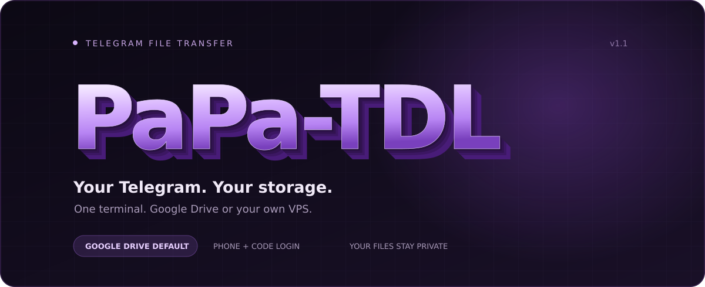

<p align="center">
  
</p>

<p align="center">
  <a href="README.fa.md">فارسی</a> ·
  <a href="#install">Install</a> ·
  <a href="#first-launch">First launch</a> ·
  <a href="#connect-google-drive">Google Drive</a> ·
  <a href="#commands">Commands</a>
</p>

**Save Telegram files to Google Drive or a local folder.** PaPa-TDL signs in through Telegram Web with your phone and code, then watches a group you can access. It runs on Linux, macOS, and Windows with Python 3.11+ and Playwright Chromium. No QR camera, personal Telegram API ID/hash, paid backend, Docker daemon, or systemd is needed.

Google Drive is the default destination. Prefer your VPS? Choose **local** during setup. Files stay private in both modes.

## Install

The one-command installer supports **Ubuntu 24.04+ and Debian 12+**. Allow enough disk space for Chromium and your downloads. Your host must permit Chromium and background processes.

```bash
sudo bash -c "$(curl --proto '=https' --tlsv1.2 -fsSL https://raw.githubusercontent.com/ValtorByte/PaPa-TDL/main/install.sh)" @ install
```

To install a checkout or an extracted release instead:

```bash
sudo bash install.sh install
```

Then open the app:

```bash
papa-tdl
```

The installer prints the runtime user and private data path. The application runs as a non-root account, even when installed by root. It uses the distro's Python by default and bootstraps a private venv with pip's `--python` option, avoiding the `ensurepip` step that can fail in mixed Python installations.

For **other Linux distributions or macOS**, clone this repository and install into a Python 3.11+ environment:

```bash
python3 -m venv .venv
. .venv/bin/activate
python -m pip install .
python -m playwright install chromium
# For RAR/7z batches, install 7-Zip with your OS package manager.
python -m tdl_watcher
```

For **Windows PowerShell** in a clone of this repository:

```powershell
py -3.12 -m venv .venv
.\.venv\Scripts\python.exe -m pip install .
.\.venv\Scripts\python.exe -m playwright install chromium
.\.venv\Scripts\python.exe -m tdl_watcher
```

On these manual installs, the app runs as your current user. On Linux and macOS its private data defaults to your user data directory; on Windows it defaults to `%LOCALAPPDATA%\PaPa-TDL`. Set `TDL_DATA_DIR` to another dedicated absolute path if needed. The platform must support Playwright Chromium; minimal servers may need additional browser system libraries. The automated installer manages those dependencies on its supported Ubuntu/Debian releases.

## First launch

The first interactive launch opens the setup wizard. Press **Enter** to accept a default:

| Setting | Default |
| --- | --- |
| Storage | Google Drive |
| Drive folder | `TDL`, created/reused after Google sign-in |
| Telegram group | `TDL` |
| Local save folder | `DATA_DIR/downloads`, created automatically |
| Temporary transfers | `DATA_DIR/pending` |

1. Choose **drive** or **local**. Leave the folder blank to use the automatic default.
2. Connect Google if you chose Drive: open the printed HTTPS link on your phone or computer and approve access. The VPS continues automatically.
3. Connect Telegram: type an international phone number such as `+989123456789`. Iranian mobile numbers starting `09` also work. **The phone number is visible while typing; the login code and two-step password are hidden.**
4. Create/use your Telegram group **TDL** and send a small document to it.
5. Choose **Check destination**, then **Start background watcher**.
6. Open **View logs** to confirm `Saved` and check the actual destination.

The menu shows the configured destination and recent verified account checks. A saved session with no recent check is labeled **unverified** rather than connected. Existing valid sessions are reused; setup does not ask for a new login on every launch.

## Connect Google Drive

Skip this section if you selected **local**. Google still requires your consent; the program cannot connect to an arbitrary Drive account without authorization.

Run `papa-tdl drive-login`, open the printed HTTPS link on any computer or phone, and approve Google access. The browser displays success and your VPS checks the private TDL folder automatically. Keep the VPS command running until it prints `Google Drive connected`. No JSON, Client ID, copied code or SSH tunnel is required for this default flow. The hosted authentication service must be operational; maintainers must complete [service activation](ops/HOSTED-OAUTH.md) before publishing this version.

The sign-in service temporarily handles authorization tokens and processes refresh requests. Your VPS stores its own private refresh token. Media transfers go directly between your runtime and Google Drive. See the [privacy policy](https://valtorbyte.ir/papa-tdl/privacy/). The following Desktop instructions are an optional independent alternative, not the normal setup.

**Optional: use your own OAuth app instead:**

1. In [Google Cloud Console](https://console.cloud.google.com/), enable the **Google Drive API**.
2. Configure the OAuth consent screen. If its status is **Testing**, add your Google account as a test user.
3. Create an OAuth client of type **Desktop app** and download its JSON file. This identifies your app to Google; it is not your Google account password.

Put the JSON at `DATA_DIR/google-client.json` (see `papa-tdl status` for `DATA_DIR`) and make it readable only by the app's runtime user. Or provide its readable path with `--client-file`; normal startup does not prompt for JSON. A file under `/root` cannot usually be read by the non-root app. Never commit the JSON or token files to GitHub.

If PaPa-TDL runs on a **VPS**, open a second terminal on **your own computer** and keep this SSH forward open:

```bash
ssh -N -L 53682:127.0.0.1:53682 YOUR_SSH_USER@YOUR_VPS
```

In the **VPS terminal**, run:

```bash
papa-tdl drive-login --method browser
```

Open the printed Google sign-in URL in your computer's browser and approve access. Google redirects to your computer's loopback address, and the SSH forward carries that response to PaPa-TDL. Leave both terminals open. Once the Drive folder is checked, the VPS prints `Google Drive connected`. **There is no TV code to enter.** If the app runs on the same computer as your browser, no SSH forward is needed.

If the JSON is stored elsewhere, run:

```bash
papa-tdl drive-login --method browser --client-file /absolute/path/to/desktop-client.json
```

The legacy `--method device` option requires your own TV OAuth client and supports only scopes Google permits for device clients; it is not the recommended Drive setup. Normal hosted sign-in uses the maintainer's Web client, whose secret stays on the central server.

Now run:

```bash
papa-tdl check
papa-tdl login
papa-tdl start
papa-tdl logs -f
```

The default Drive folder is **TDL**. You do not need to enter a folder ID. A custom folder must already be accessible to this OAuth app because it uses the limited `drive.file` scope. Refresh tokens are private and are refreshed when Google permits; revoked access or an expired testing-mode grant needs another `drive-login`.

## Save on the VPS

Run `papa-tdl setup` and select **local**. Press Enter at the output prompt to use the prepared default folder, or enter an absolute writable directory. Google sign-in is not needed.

```bash
papa-tdl setup
papa-tdl login
papa-tdl check
papa-tdl start
```

To override the local path for a single run:

```bash
papa-tdl start --output /home/YOUR_USER/telegram-files
```

For a system directory, an administrator must first create it for the application's runtime user:

```bash
sudo install -d -m 700 -o RUNTIME_USER /srv/tdl
papa-tdl start --output /srv/tdl
```

Files are saved privately. The tool does not publish a web server or make local files available over a public URL.

## Commands

### Extract archives from Telegram

Send ZIP, RAR or 7z archives to the configured private Telegram group. The watcher recognizes related volume names such as `.part1.rar`, `.part2.rar`, `.7z.001` and `.zip.001`. It also groups archives sent as one Telegram album. After no new part has arrived for 30 seconds, it downloads all parts, extracts them together and saves one folder inside `TDL`. Ordinary archives are extracted automatically too.

For a custom batch, you can still send `/extract`, then the files, then `/done`. If a part is missing or extraction fails, the files stay in the private recovery area. Open **Live service** from menu option 1, or run `papa-tdl console`. Encrypted archives request their password directly in this view; an incorrect password can be retried there. Foreground watching (option 3) also prompts in the same terminal. Passwords and extraction errors stay in the terminal, not in the Telegram group. Ctrl+C returns directly to the menu; the background service continues running. The optional `papa-tdl extract-password` command sends a one-time password over a private local socket without saving it to disk. Failed archive batches retain their parts, while ordinary files and other archive batches can continue. A restart reuses staged parts and skips verified destination files.

Telegram Web shows rounded file sizes. PaPa-TDL records the exact byte count of each completed browser download for restart checks. If an archive itself is missing or damaged, PaPa-TDL cannot reconstruct it; supply a complete copy of the affected volume.

Archive extraction rejects traversal paths and symbolic links. The Ubuntu/Debian installer includes 7-Zip and installs RAR support when the distribution offers it. Manual installations need `unrar` or a RAR-capable 7-Zip package for RAR, and `7zz`, `7z` or `7za` for 7z and split archives.

| Command | Action |
| --- | --- |
| `papa-tdl` | Open the menu; run the wizard if no settings exist |
| `papa-tdl setup` | Change the destination, group or local save path |
| `papa-tdl login` | Connect/reconnect Telegram with phone and code |
| `papa-tdl drive-login` | Open normal Google browser sign-in and detect approval automatically |
| `papa-tdl check` | Verify the configured destination; prepare its folder |
| `papa-tdl start` | Start the background watcher |
| `papa-tdl console` | Open the live service with automatic hidden password prompts and errors |
| `papa-tdl status` | Show watcher status and the private data path |
| `papa-tdl logs -f` | Follow progress; Ctrl+C closes only the log viewer |
| `papa-tdl stop` | Stop watching; retain sessions, saved files and pending transfers |
| `papa-tdl list` | List currently rendered Telegram media IDs |
| `papa-tdl telegram --ids 55,56 --once` | Transfer selected rendered messages |
| `papa-tdl retry` | Retry complete local pending files |

Use `--to drive` or `--to local` on transfer/check/start commands for a one-run destination change. `--output /absolute/path` implies local storage. `--group NAME` overrides the Telegram group. As an extra, `papa-tdl download` accepts a direct HTTP(S) file URL through a hidden prompt; it is not a Telegram message-link resolver.

The background watcher survives a terminal or SSH disconnection. **After a reboot, run `papa-tdl start` again** or arrange startup with your host's process manager. Stop the watcher before setup, login or update; one profile is used by one operation at a time. On Windows, use the same commands through `.\.venv\Scripts\python.exe -m tdl_watcher`.

## Duplicates, privacy and limits

Before downloading, the app checks the selected destination for the Telegram chat/message identity. A safe original filename follows a stable prefix such as `tdlmsg-v1-5487220585_55__video.mp4`. Keep the prefix for restart deduplication. Reposting the same content under a new message ID is a separate file; manually uploaded files without the prefix cannot be recognized before download.

A complete pending file is kept until the destination verifies it. Drive verifies size and MD5; local saves verify size. Restarting an unfinished Drive upload may resend the retained local file from byte zero, without downloading that completed copy from Telegram again. Complete pending transfers before changing folders/accounts.

Telegram Web only renders part of a chat. This is a watcher for rendered recent/new media, **not a complete historical exporter**. Bursts, outages, saving restrictions, missing messages, browser failures and Telegram interface changes can cause missed/unsupported transfers. Account permissions and protected-media controls are never bypassed.

Google files remain private. Printed view URLs require access and are not anonymous direct-download links. Never share your Telegram profile, Google OAuth JSON, tokens or private data directory.

To inspect a saved Drive file, run `papa-tdl share FILE_ID`; this prints its view URL and sharing status without changing permissions. To opt in to public read access, run `papa-tdl share FILE_ID --public` and type `PUBLIC` at the warning. For unattended use, `--public --yes` is an explicit opt-in. A public file receives a `drive.google.com/uc?export=download&id=...` URL, but Google may still show a confirmation page or apply download quotas. A private file has no anonymous direct-download URL.

## Update / troubleshooting

From the latest checkout or extracted release on the VPS:

```bash
papa-tdl stop
sudo bash install.sh update
papa-tdl --version
papa-tdl
```

If you use the remote one-command installer, first publish the new source to GitHub and check that the fetched script prints `INSTALLER 1.6.6`. An older `main` script will still run the older installer.

If the Playwright browser CDN returns a regional 403, the installer automatically uses an existing system browser or tries the official Chrome system package. The selected executable is saved in the launcher, so normal runs do not download a browser again.

| Symptom | What to do |
| --- | --- |
| `ensurepip ... non-zero exit status` | Use installer 1.2 or newer. It creates the venv with `--without-pip` and installs pip through the system interpreter. |
| Phone entry seems invisible | Update to 1.2 or newer. Phone entry now echoes; only the code and two-step password are hidden. |
| `papa-tdl: command not found` after a failed install | Finish installation successfully first. For a non-root install, also add `~/.local/bin` to PATH. |
| `System has not been booted with systemd` | The native installer does not call systemctl. Use `papa-tdl start/stop/status` instead. |
| Drive is not connected | Run `papa-tdl drive-login`, approve the browser link and wait for `Google Drive connected`; or select local in setup. |
| `TV OAuth client ID` appears | You are running an older version or explicitly selected `--method device`; update and use `papa-tdl drive-login`. |
| No Google login URL appears | Check connectivity to the PaPa-TDL authentication service and retry. Users do not need an OAuth JSON for hosted sign-in. |
| OAuth JSON cannot be read | Move it out of `/root` to the private data directory and assign it to the runtime user. |
| Google approved, but the VPS times out | Keep drive-login running and use a fresh link if it expires. SSH forwarding is needed only for the optional --method browser flow. |
| Telegram is signed out | Stop the watcher and run `papa-tdl login` in an interactive terminal/tmux. |
| Local path is not writable | Create a dedicated directory owned by the runtime user. |

The installer retains the private data directory during updates. Program releases are stored separately. It supports `PAPA_TDL_REPO`, `PAPA_TDL_REF`, `PAPA_TDL_PREFIX`, `PAPA_TDL_BIN_DIR`, `PAPA_TDL_DATA_DIR`, `PAPA_TDL_USER` and `PAPA_TDL_PYTHON`. For preconfigured hosts, `--skip-system-deps` requires Python 3.11+, Chromium OS dependencies and a bootstrap interpreter with pip 22.3+; set `PAPA_TDL_BOOTSTRAP_PYTHON` if it differs from the target interpreter.

## Development

See [CONTRIBUTING.md](CONTRIBUTING.md) and [VALIDATION.md](VALIDATION.md). Environment overrides are documented in [.env.example](.env.example). Optional Docker deployment is available in `compose.yaml`; it requires a working Docker daemon.

MIT licensed. Terminal wordmark uses the [ANSI Shadow FIGlet font from TAAG](https://patorjk.com/software/taag/#p=display&f=ANSI%20Shadow&t=PaPa-TDL). [Google device OAuth reference](https://developers.google.com/identity/protocols/oauth2/limited-input-device) · [Desktop OAuth reference](https://developers.google.com/identity/protocols/oauth2/native-app) · [pip's Python environment option](https://pip.pypa.io/en/stable/topics/python-option/)

See [CHANGELOG.md](CHANGELOG.md) for release and migration notes and [VALIDATION.md](VALIDATION.md) for checks that have and have not been performed.


## Product website

Static product, privacy and terms pages are in [site/](site/DEPLOYMENT.md). Deployment on hunt requires an administrator; source pages alone do not publish the website.
